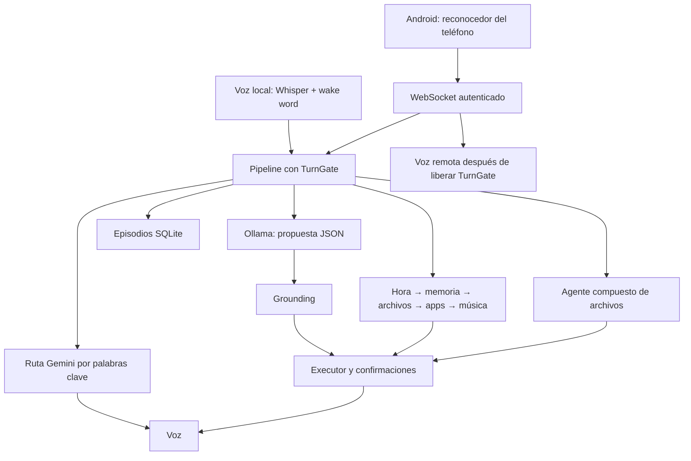

# Auditoría de Limits — 30 de octubre de 2026

## Dictamen

Limits tiene una base funcional de prealfa: rutas deterministas rápidas, un router local pequeño, separación por módulos y 263 pruebas que pasan. El corpus de 32 órdenes obtiene 100 % en este equipo. Sin embargo, **el cortafuegos de ejecución todavía admite vías de ejecución arbitraria**, y la integración móvil rompe garantías de memoria y serialización de voz. Recomiendo resolver los P1 antes de ampliar funciones de escritorio o presentar el sistema como estable.

Esta auditoría analiza la implementación actual; no aplica las correcciones. Los cambios previos en los documentos de P2 se conservaron.

## Alcance y validación

Revisión del orquestador, configuración, router, grounding, executor, todos los dominios de comandos, memoria, agente compuesto, Gemini, motores de voz, interrupciones, gateway, cliente Android, lanzadores, instalación, diagnóstico, prompt y pruebas. Los planes pendientes se consideran diseño, no funcionalidad implementada.

| Comprobación | Resultado |
|---|---|
| Compilación Python de entrada, configuración, versión, módulos, comandos y scripts | Correcta |
| `unittest discover -s tests -v` | 263 pruebas, 5,071 s, todas pasan |
| Dependencias instaladas | `pip check` correcto; versiones declaradas coinciden con el entorno |
| Router real, memoria desactivada para aislar la medición | 32/32; mediana 1.567 ms; p95 3.186 ms; media 1.572 ms |
| Sonda adicional real | 8 frases; cero silencios según su criterio, pero bloquea peticiones legítimas |
| Smoke de hora por el pipeline compartido | Responde sin consultar al LLM |
| Android, compilación sin red | `assembleDebug` correcto, 13 s |
| Android, pruebas unitarias | `testDebugUnitTest NO-SOURCE`: no hay pruebas que ejecutar |
| Reproducciones aisladas | Shell, ejecutable fuera del catálogo, memoria entre hilos, token, confirmación, path guard y voz remota |

No se ejecutaron apagados, movimientos de archivos del usuario ni comandos de las reproducciones: las llamadas de ejecución se sustituyeron por dobles de prueba. Las bases de datos y tokens de prueba fueron temporales. No se consultaron recuerdos privados ni se enviaron consultas a Gemini, OpenCode o ElevenLabs. No se probó audio físico, casting real ni la app instalada en un teléfono; la compilación Android no demuestra su funcionamiento extremo a extremo.

Estado observado: `limits.service` inactivo (`dead`, cero reinicios registrados); Ollama responde y tiene los modelos 1.5b y 3b. La configuración efectiva usa router 1.5b, contexto 8192, Whisper small/CPU; Gemini, ElevenLabs, gateway y memoria habilitados. Esto describe la configuración, no demuestra que sus credenciales o dispositivos funcionen.

## Arquitectura efectiva

El router de intents es local. El producto completo puede usar servicios externos: Gemini conversacional, OpenCode para tareas compuestas, ElevenLabs, búsquedas web y multimedia. Android reconoce voz mediante el proveedor del teléfono. Estas fronteras deben mantenerse visibles en la documentación.

Fortalezas: salida de Gemini tratada como texto, SQL parametrizado, catálogo de acciones central, filtro de kwargs, confirmación para cuatro operaciones sensibles, rutas deterministas separadas, límites de historial y cache, token de emparejamiento y URLs temporales de media, pruebas extensas de funciones individuales.

## Hallazgos prioritarios

P1 = corregir antes de ampliar uso; P2 = siguiente ciclo de fiabilidad. La prioridad expresa impacto y alcance, no una afirmación de explotación externa observada.

### 1. P1 — La terminal visible permite inyección de shell

**Ubicación:** `commands/dev.py:53–69`, también `commands/dev.py:155`.

La allowlist valida el prefijo y luego `show_output=True` interpola el texto en `bash -c`. Una lista de argumentos en `Popen` no evita la interpretación porque se está invocando expresamente un shell. La reproducción con `echo inocuo; echo SEGUNDO_COMANDO` muestra ambos comandos dentro del argumento de Bash, después de superar la allowlist. El executor acepta `show_output` sin exigir confirmación para esta acción.

`open_project` también construye un programa Bash con una ruta entre comillas simples; una ruta existente con una comilla puede romper ese encuadre.

**Corrección:** lanzar argumentos validados directamente; usar `cwd=` para abrir proyectos. Si hace falta mantener visible una terminal, usar un programa fijo que reciba argumentos separados, sin interpolación de entradas.

### 2. P1 — Abrir aplicaciones salta el catálogo y permite ejecutar intérpretes

**Ubicación:** `commands/apps.py:47–50`; `modules/grounding.py:145–197`.

`APP_MAP.get(app.lower(), [app])` acepta cualquier ejecutable desconocido y añade los argumentos propuestos por el modelo. El grounding valida el nombre de la acción, pero no exige evidencia para `open_application` ni valida el catálogo de aplicaciones o sus argumentos.

**Reproducción:** ante el texto `hola`, una propuesta con `app=python3`, `args=["-c", "print(...)"]` obtiene `grounded=True` y llega a `Popen` sin confirmación. Esto demuestra un fallo del límite de ejecución; no que el modelo haya producido esa propuesta espontáneamente durante la auditoría. Incluso una app permitida como una terminal necesita restricciones de argumentos.

**Corrección:** catálogo cerrado en el handler, esquemas de argumentos por aplicación y validación determinista de la relación entre petición y acción. Aplicar el criterio también al cierre de procesos.

### 3. P1 — La allowlist permite opciones destructivas aunque se elimine el shell

**Ubicación:** `commands/dev.py:16–39,53–82`.

Permitir cualquier sufijo de `git branch` admite `git branch -D ...`; `git diff` también acepta opciones que escriben archivos. La protección actual controla prefijos, no capacidades. Reproduje que el borrado de rama pasa hasta la llamada a `subprocess.run`, sustituida por un mock.

**Corrección:** parsear tokens y permitir subcomandos y opciones concretos de consulta. Las operaciones que modifican estado deben tener handlers y confirmaciones propios. Probar argumentos adversos, no solo prefijos parecidos.

### 4. P1 — La memoria falla al cambiar de hilo

**Ubicación:** `modules/memory.py:129,159–179,284–303`; `modules/gateway.py:482`.

El singleton guarda una conexión SQLite con afinidad al hilo que la creó. El gateway ejecuta el pipeline mediante `asyncio.to_thread`; serializar los turnos no garantiza que usen ese hilo. La memoria puede funcionar en voz local y fallar desde el móvil, o viceversa, según quién la inicialice.

**Reproducción:** una consulta que devuelve un hecho en el hilo original devuelve `[]` desde otro hilo; guardar responde «No he podido guardarlo» y las estadísticas aparentan memoria desactivada. Los errores se absorben.

**Corrección:** un trabajador dedicado de memoria o conexiones administradas por hilo; alternativamente una conexión compartida con acceso explícitamente sincronizado y configuración adecuada. Añadir una prueba alternando voz y gateway, con escritura y recuperación de episodios.

### 5. P1 — La voz remota queda fuera de la serialización del turno

**Ubicación:** `main.py:214`; `modules/gateway.py:478–496`; `modules/speech_controller.py:99–101`.

El gateway pide `pipeline(..., speak=False)`, que libera `TurnGate`, y reproduce después mediante `speak_fn`. Mientras habla pueden comenzar otro turno local o remoto y otra llamada a `SpeechController.speak`. Comparten `pending_text`, el evento de parada y los procesos globales de audio.

**Reproducción:** el callback de voz remota pudo adquirir `TurnGate` inmediatamente. El problema afecta además a la captura: el bucle local puede seguir escuchando mientras la voz remota abre otra escucha de barge-in sobre el mismo STT. Los comandos detectados durante TTS remoto no tienen un consumidor inmediato equivalente al encadenamiento del bucle local.

**Corrección:** un único coordinador de turno, audio y captura. Enviar el texto temprano mediante un callback/evento, conservando la exclusión hasta terminar la voz. Mantener la interrupción fuera de esa espera.

### 6. P1 — La confirmación pendiente puede sobrevivir a otro comando y aceptar una propuesta débil

**Ubicación:** `main.py:93–106`; `modules/executor.py:154–178`; `modules/grounding.py:145–197`.

Gemini por palabra clave evita `executor.execute`, por lo que no cancela una acción pendiente. Una propuesta rechazada por grounding también retorna antes de limpiarla. Posteriormente `action="confirm"` ejecuta lo pendiente antes de comprobar la confianza; el grounding acepta `confirm` para cualquier frase. El código decide por `action`, aunque el contrato describe `intent` dedicado; no comprueba coherencia entre ambos.

**Reproducción:** preparar un apagado simulado → conversar con Gemini → permanece pendiente → propuesta `confirm` con confianza 0,01 ejecuta el mock. No se apagó el sistema.

**Corrección:** confirmar/cancelar en una ruta determinista con expresiones completas; vincular el pendiente a un turno/origen, dar caducidad, mostrar qué se confirma y cancelarlo ante cualquier otra solicitud. Validar el protocolo antes de consumirlo.

### 7. P1 — Rotar el token no revoca el token del servidor activo

**Ubicación:** `modules/gateway.py:96–103,249,395`; `scripts/show_pairing.py:52–54`.

La rotación cambia el archivo, pero `GatewayServer` compara siempre con `self.token`, leído al construirlo. Las conexiones abiertas tampoco se reautentican. El script afirma «Token revocado» sin reiniciar ni notificar al gateway.

**Reproducción:** después de regenerar un token temporal, el archivo contiene uno nuevo y el objeto servidor conserva el anterior. Hasta reiniciar/recargar, el nuevo QR no autentica y el anterior sigue siendo válido.

**Corrección:** revocación coordinada con recarga y cierre de sesiones, o reinicio explícito controlado y mensaje honesto sobre cuándo tiene efecto.

### 8. P1 — La privacidad de los logs no se cumple de extremo a extremo

**Ubicación:** `modules/gemini.py:189–191,215–227`; `modules/gateway.py:163`; `main.py:367–369`; `setup-service.sh`.

Gemini registra hasta 200 caracteres de respuesta a INFO y previews a WARNING; las salidas no parseables incluyen colas de stdout/stderr a ERROR. El QR imprime el token completo; está habilitado por defecto y en la configuración actual. Bajo systemd, stdout acaba normalmente en el journal. STT, LLM y TTS también imprimen transcripciones/respuestas a consola, por lo que mantener únicamente `log.debug(INPUT/RESPONSE)` no basta para evitar persistencia del contenido.

**Corrección:** separar interfaz interactiva y salida del servicio; logs con metadatos sin contenido, redacción central y QR solo bajo petición interactiva. No se leyeron logs privados para este diagnóstico: se identificaron los caminos de escritura.

### 9. P2 — Gemini intercepta comandos por coincidencias dentro de nombres

**Ubicación:** `modules/gemini.py:70–113`; `main.py:90–107`.

La ruta tiene prioridad sobre memoria y archivos y busca raíces en cualquier parte del texto. Tanto «recuerda que mi proyecto es investigación» como «abre el archivo ~/Documentos/investigacion.pdf» se clasifican como research. El primer caso no guarda el hecho; el segundo no abre el archivo y puede enviar la petición/ruta a Gemini.

**Corrección:** detectar intención por estructura de la petición y prioridad de rutas específicas; añadir estos casos negativos. No basta con agregar más palabras clave.

### 10. P2 — El path guard acepta resultados de turnos anteriores

**Ubicación:** `modules/desktop_agent.py:267–302`.

Se reinicia `_observed_paths`, pero `_path_guard` permite cualquier ruta de `files.last_matches`, que persiste entre turnos, y `_ingest_observations` incorpora estado previo. `open_last` tampoco distingue el turno. La regla documentada «observada en este turno» no se cumple.

**Reproducción:** un `copy_file` con una ruta solo presente en `last_matches` del turno anterior pasa el guard con el conjunto actual vacío.

**Corrección:** distinguir referencias explícitas de seguimiento y observaciones nuevas mediante identificadores de turno; no tratar todo el historial de archivos como evidencia nueva. Las propuestas de movimiento/renombrado también deberían comprobar la procedencia de sus rutas.

### 11. P2 — El modo de voz `gemini` no recibe el origen

**Ubicación:** `main.py:105,203`; `modules/gateway.py:489`; `modules/tts.py:288–294`.

Las llamadas al TTS pasan solamente texto, con `source="system"` por defecto. `VoiceRouter(mode="gemini")` exige `source="gemini"`; por ello esas respuestas usan Piper. En la configuración actual `auto` puede ocultar el fallo al seleccionar por longitud.

**Corrección:** transportar texto, origen y estado como resultado del pipeline, y preservar el origen también en el gateway. Reproducción: la llamada a `speak` tras Gemini no contiene el argumento de origen.

### 12. P2 — Los catálogos, el prompt y algunos handlers no coinciden

**Ubicación:** `prompts/system_prompt.txt:12`; `modules/executor.py:52`; `modules/grounding.py:105`; `commands/tv.py:75`.

- El prompt enseña `list_running`; el executor registra `list_running_apps`. La acción enseñada es rechazada como desconocida.
- El grounding permite `tv_control(next/previous)`, que el handler no soporta; rechaza `rewind/volume_mute`, que sí soporta.
- `remember/forget` siguen accesibles al LLM sin evidencia explícita. Una propuesta `remember` para «hola» pasa el grounding, contrariando la regla de memoria exclusivamente explícita.

**Corrección:** un registro compartido de acciones, parámetros, peligrosidad y restricciones; probar automáticamente coherencia de prompt/registro/enums. Limitar las escrituras de memoria a la ruta explícita.

### 13. P2 — Casting local incompleto y selección de TV equivocada

**Ubicación:** `commands/tv.py:127–175,195–202`.

`media_url_factory` se configura y el helper `resolve_local_file` existe, pero `_resolve` no lo usa. `source=current` descarta URLs `file://`; una ruta local como query termina como búsqueda de YouTube. La infraestructura de servir media está implementada, pero el flujo público de casting local no está conectado.

Además, pedir una TV cuyo nombre no coincide devuelve el primer receptor. Reproducción: pedir «Dormitorio» con solo «Sala» devuelve Sala.

**Corrección:** conectar la resolución local y no sustituir silenciosamente un destino explícito inexistente. Las páginas web de YouTube y streams directos también necesitan tratamiento diferenciado; su reproducción no se validó con TV física.

## Fiabilidad, contexto y mantenimiento

1. **Historial incompleto y distinto tras reiniciar.** Solo `LLMEngine.process` actualiza el historial activo; las rutas deterministas y Gemini registran episodios, pero no actualizan ese historial. Al reiniciar se hidrata texto hablado, mientras durante ejecución se guardan respuestas JSON del router. El modelo no tiene una vista consistente de los últimos turnos. Centralizar el registro del contexto con procedencia y resultado real.
2. **Olvido parcial.** `forget` elimina `facts`, pero deja `fact_history` y episodios. Se reprodujo un registro histórico superviviente. Si «olvida» debe implicar borrado de datos personales, definir y cumplir su alcance; no anunciar borrado total con este comportamiento.
3. **Selección de recuerdos frágil.** Un hecho más reciente que no cabe en 600 bytes produce `break` y deja fuera hechos pequeños posteriores. Reproducción adicional con un hecho largo de texto normal: bloque vacío. Usar selección acotada por relevancia/tamaño, evitando cortar todo el bloque por un único elemento.
4. **Presupuesto de prompt.** Crudo: 6.737 bytes, por encima del objetivo aproximado de 6 KB; renderizado sin recuerdos: 7.475 bytes en este equipo, por debajo de 8.400. No conviene reducir `num_ctx=8192`. Las entradas y respuestas de historial no tienen límites de bytes propios, y el presupuesto no está garantizado ante entradas remotas largas.
5. **Gateway sin admisión acotada.** Crea una tarea por mensaje, sin límite de comandos en vuelo ni longitud funcional del texto. Cancelar la tarea de asyncio al desconectar no detiene automáticamente una ejecución síncrona ya iniciada en el thread pool. Añadir cola limitada, IDs de petición y política explícita de cancelación. Esto es revisión del flujo, no una prueba de carga realizada.
6. **Arranque del gateway anunciado antes de verificarse.** `start` lanza un hilo y retorna sin esperar confirmación de bind. El `except OSError` de `main` no cubre de forma fiable el error ocurrido dentro del hilo. Esperar readiness o fallo y limpiar mDNS si no escucha.
7. **Timeouts incompletos.** Hay 11 llamadas `subprocess.run` sin timeout, incluidas 10 en comandos. Un proceso bloqueado puede retener el turno. La comprobación inicial de Ollama solo captura `ConnectionError`, no todo `RequestException`, y puede romper el arranque con un timeout.
8. **Resultados de éxito demasiado optimistas.** Varios handlers imprimen fallos y devuelven `None` o ignoran códigos de salida; `_run` conserva el «Abriendo/Hecho» del modelo. Spotify no verifica que esté reproduciendo el contenido solicitado. Los reproductores TTS devuelven `ok` sin comprobar su código final; un fallo de playback puede evitar el fallback. Usar resultados estructurados de éxito/error antes de redactar la respuesta.
9. **Audio y apagado requieren integración real.** STT no cierra el stream con `finally` ante fallos de lectura; SIGTERM solo cambia una bandera y no cancela el turno/voz/consulta en curso. La escucha de wake word compara substrings y convierte toda la orden a minúsculas, lo que puede alterar nombres sensibles a mayúsculas. Revisar sin debilitar la protección de eco y probar con hardware.
10. **Configuración inconsistente.** `Config.OLLAMA_MODEL` por defecto es 3b, aunque README, ejemplo y decisión documentada indican 1.5b. Este equipo lo corrige mediante `.env`. `get_time` no pasa `TIMEZONE`, pero el prompt sí lo usa: pueden discrepar si se configura una zona distinta. `healthcheck.py` lee variables directamente sin cargar `Config/.env`, siempre exige gateway y asume loopback.
11. **Instalación poco portable.** Lanzador y servicio asumen `~/Proyectos/Limits`; el servicio fija `wayland-1`. `--takeover` solo se retira cuando el servicio está activo, por lo que con servicio detenido termina como argumento desconocido de `main`. La dependencia `groq` sigue instalada y declarada, aunque no participa en el router.
12. **Android compila, pero faltan pruebas de sesión.** Se declara conectado al hacer upgrade, antes de recibir `welcome` autenticado; un token rechazado puede mostrar conexión transitoria. No se implementa `onClosing` para completar explícitamente el cierre de OkHttp, y se espera `onClosed` para reconectar: revisar el handshake con una prueba real de rechazo/reconexión. El historial en memoria crece sin límite. No hay foreground service; es un cliente de pantalla, no control persistente en segundo plano.

El transporte `ws://` y HTTP de media están deliberadamente diseñados para una LAN de confianza; el token autentica, no cifra. No atribuyo esto a una regresión, pero «LAN-only» no es una restricción de red implementada: el bind `0.0.0.0` escucha todas las interfaces IPv4 disponibles. Una ampliación a otras redes requiere otra política de transporte y acceso.

## Qué demuestran realmente las métricas

El 100 % del corpus es real para sus 32 frases y esta ejecución, pero mide principalmente **el nombre de acción**, no la corrección completa de parámetros, ejecución, voz ni contexto. `measure_router.py` replica parcialmente el pipeline: omite las rutas de hora, memoria y Gemini. Conserva historial entre frases, por lo que también depende del orden del corpus.

La sonda de ocho frases se declara correcta por «cero silencios». En esta ejecución el LLM propuso apagar ante «estoy cansado» y el grounding lo bloqueó correctamente. También propuso investigación para una traducción y un resumen histórico, que quedaron bloqueados. La protección evita acciones equivocadas, pero todavía hay limitaciones conversacionales y falsos negativos. No se debe aflojar el grounding para mejorar artificialmente esa cifra.

No hay medición nueva de latencia de STT, síntesis, audio completo, GPU/CPU bajo concurrencia, consumo prolongado ni cuota de proveedores externos. El p50 de 1,57 s corresponde a clasificación combinada con rutas deterministas, no al tiempo de respuesta hablado extremo a extremo.

## Orden recomendado de trabajo

1. **Cerrar ejecución y confirmaciones:** eliminar shell interpolado, cerrar apps/argumentos y opciones de terminal, confirmar de forma determinista, exigir memoria explícita. Añadir reproducciones como pruebas de regresión.
2. **Reparar concurrencia:** memoria con modelo de hilos definido; un coordinador para turnos y audio; cola remota acotada; contexto y pendientes con procedencia.
3. **Corregir autenticación y privacidad:** rotación efectiva, sesiones revocables y salida de servicio sin tokens/conversaciones.
4. **Unificar contratos:** registro de acciones y enums, resultado estructurado del pipeline, origen de voz, contexto compartido y medición a través de la misma función de selección.
5. **Completar integraciones y diagnóstico:** casting local/selección de TV, Android autenticación/reconexión, timeouts, disponibilidad y smoke extremo a extremo.
6. **Ampliar capacidades de P2:** visión, workspaces y memoria de sesión, después de contar con los límites anteriores verificados.

## Evidencia reproducible

- `router.json`: resultado completo de las 32 frases con latencias.
- `sonda-grounding.txt`: salida de las ocho frases adicionales.
- `reproducciones.json`: resultados de pruebas aisladas de los fallos principales.
- `comprobaciones.json`: validación adicional de catálogos, rutas y presupuesto de prompt.
- `reproducir.py`: reproduce los fallos principales con procesos simulados y memoria/tokens temporales. Ejecutar desde la raíz del proyecto: `MEMORY_ENABLED=false ./limits-env/bin/python docs/auditorias/2026-10-30/reproducir.py`. Genera también `/tmp/limits-audit-probes.json`.
