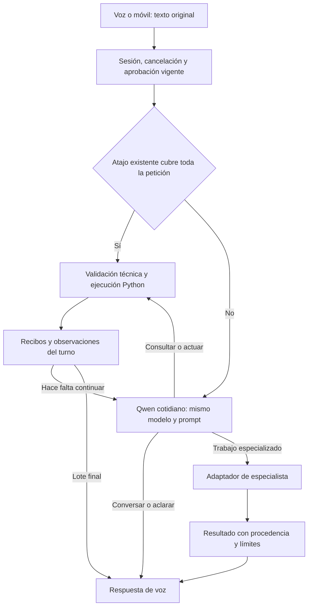

# Mejora 8 · Un asistente cotidiano, un ciclo y herramientas verificables

Fecha: 2026-11-01. Estado: **implementada y activa; aceptación funcional pendiente**.
Tarea: [lista de implementación](tasks/mejora-8-agente-unico.md).
Base revisada: commit `8b13f0e`, modo `AGENT_MODE=conversacional`.

## 1. Decisión y grado de certeza

La arquitectura es viable: un modelo interpreta, conversa y elige herramientas;
Python las ejecuta y devuelve observaciones al mismo modelo cuando debe continuar.
Se reutilizan los handlers, el ciclo, los recibos y la infraestructura existentes.
No se necesita n8n, otro framework, otro coordinador ni entrenar pesos para realizar
esta reorganización.

La arquitectura puede garantizar contratos técnicos, límites de ejecución,
cancelación y estados honestos. No puede garantizar comprensión universal, ausencia
de alucinaciones o una latencia concreta de Qwen 3B. La selección inicial conserva
ese modelo instalado para aislar el cambio de arquitectura; su idoneidad sigue
pendiente de las conversaciones reales del usuario. Si no alcanza el nivel deseado,
se revisará el modelo sin reconstruir el ciclo ni añadir reglas por frase.

**No se ejecutarán tests, probes, consultas de aceptación a modelos ni pruebas de
voz guiadas.** Se permite revisión estática, sintaxis y comprobación de arranque.
La aceptación funcional quedará separada y pendiente del uso libre del usuario.

## 2. Problemas demostrados y causas que se eliminan

Último turno observado: «muévete al espacio de trabajo tres», id
`91c65b4b48954a2fad9ffd7b56b9d8e2`.

| Etapa actual | Evidencia | Consecuencia |
|---|---|---|
| Interlocutor 3B | 10,121 s; devuelve `task` con objetivo sin destino | Reinterpreta innecesariamente una orden concreta |
| Ejecutor 1.5B | 7,353 s; devuelve chat afirmando haber cambiado | Ninguna herramienta ejecutada |
| Presentación 3B | 5,848 s; pide confirmación | Otra inferencia sin solucionar nada |
| Cierre | 23,349 s; aclaración, cero operaciones | Espera larga y orden incumplida |

Las cargas de las dos últimas inferencias sumaron aproximadamente 6,1 s. La primera
evaluación de entrada consumió 8,985 s: eliminar alternancias no elimina por sí solo
el coste del prompt. No se atribuye toda la demora al tamaño del modelo o al router.

Hallazgos en código:

- `coherent_agent.py` alterna `conversacion`, `ejecucion` y `resultado`.
- `conversation.py` ofrece `task`, reformula `goal` y presenta informes sin efectos.
- `agent_providers.py` selecciona modelo mediante papel/contexto.
- Los atajos de `compilar_rapida` se excluyen cuando `tarea.conversacional` es cierto.
- El cierre de un lote con efectos puede ocurrir aunque `complete=false`; eso impide
  continuar tareas dependientes dentro del mismo asistente.
- Una respuesta libre sin recibos puede finalizar como conversación; ningún sistema
  de recibos puede comprobar por sí solo que ese texto no encubre una orden omitida.

## 3. Objetivos y exclusiones

Objetivos:

1. Un modelo cotidiano y un único ciclo para conversación y control del equipo.
2. Cero inferencias para atajos completos; una para una operación concreta que Qwen
   resuelva directamente; continuaciones solo si faltan observaciones o trabajo.
3. Petición original inmutable, contexto acotado y resultados reales por turno.
4. Libertad para elegir capacidades sin jueces léxicos, citas literales ni traducciones
   entre modelos cotidianos.
5. Progreso audible durante esperas, resultados honestos y cancelación efectiva.
6. Cambios concentrados en componentes existentes y retirada de ramas sustituidas.

Fuera de alcance: cambiar STT/TTS, entrenar Qwen, descargar modelos, habilitar
Spotify OAuth, añadir terminal libre, reescribir memoria, rediseñar el widget,
introducir agentes paralelos o cambiar proveedores de especialistas.

## 4. Arquitectura propuesta



Los especialistas de desarrollo/análisis mantienen sus flujos autorizados de
herramientas y sandbox. La flecha de salida no convierte cualquier texto remoto en
instrucciones ejecutables. Gemini sigue entregando información/voz y artefactos;
su texto no vuelve al ciclo con capacidad de ejecutar acciones.

### 4.1 Responsabilidades

| Componente | Decide | No decide |
|---|---|---|
| Qwen | Significado, referencia conversacional, capacidad, parámetros, siguiente paso | Si una herramienta realmente tuvo éxito |
| Atajo | Una operación inequívoca soportada y completa | Cómo resolver una frase parcialmente reconocida |
| Coordinador | Ciclo, presupuesto, identidad del turno, repetición y cierre | Reinterpretar la intención por palabras clave |
| Política técnica | Tipos, catálogo, destino válido, alcance, aprobación sensible | Qué sinónimos debe emplear el usuario |
| Handler | Ejecutar y observar el resultado específico | Afirmar que toda la petición quedó cubierta |
| Voz | Entregar texto aprobado y progreso factual | Ejecutar texto generado |

## 5. Modelo y configuración

- Mantener `AGENT_MODE=conversacional`; reemplazar su interior, sin crear un cuarto
  modo ni un flag independiente por cada arreglo.
- En ese modo, `AGENT_CONVERSATION_MODEL` será el único modelo cotidiano, tanto
  antes como después de consultar herramientas. Inicialmente el 3B ya instalado.
- `OLLAMA_MODEL` conserva su significado en `local`/`legacy`; no borrarlo ni usarlo
  como segundo ejecutor en el modo nuevo.
- Resolver una vez la identidad del proveedor/modelo al abrir el turno. Registrar
  el modelo realmente invocado, no deducirlo del nombre del rol.
- Mantener contexto 8192; no reducirlo para aparentar rapidez. No cambiar cuantización,
  modelo, keep-alive y arquitectura a la vez.
- No respaldo remoto para órdenes cotidianas ni escalado a especialistas por un
  error de JSON. Las preferencias «solo local» se aplican antes de enviar datos.

## 6. Contrato de decisión

Conservar nombres compatibles y simplificar variantes. No devolver razonamientos
internos, puntuaciones de confianza, citas literales ni objetivos reescritos.

### 6.1 Operación o consulta

```json
{"intent":"command","operations":[{"action":"workspace_switch","params":{"target":"3"}}],"complete":true,"response":""}
```

Los parámetros definitivos derivan del contrato real; el ejemplo ilustra el flujo.
Hasta seis operaciones independientes por lote. `complete=true` indica que el modelo
considera que ese lote cubre la petición; no certifica que haya entendido todo.
`complete=false` mantiene el ciclo y entrega resultados al MISMO modelo.

Un lote no puede usar rutas o direcciones que todavía no hayan sido observadas.
Si B depende de A, primero se ejecuta A y después se decide B. No interpolar
referencias inventadas ni ejecutar lotes en paralelo en esta mejora.

### 6.2 Conversación y aclaración

```json
{"intent":"chat","operations":[],"complete":true,"response":"Respuesta conversacional."}
```

```json
{"intent":"clarify","operations":[],"complete":false,"response":"¿Cuál de los dos proyectos quieres abrir?"}
```

`chat` sirve para conversación y explicación, nunca constituye un recibo. Después
de haber entrado en ejecución, una respuesta sin efectos no cambia una operación
pendiente a completada. Una consulta negativa verificada puede cerrar «no encontré
el proyecto» sin exigir que se produzca un efecto imposible.

**Límite explícito:** si el modelo clasifica una orden como chat desde el primer
paso y escribe «ya lo hice», Python no puede detectar todas esas afirmaciones sin
interpretar lenguaje. No se promete resolverlo con una lista de verbos ni con otro
juez. Se instruye el modelo, se separa estado conversacional de éxito operativo y
se registra ese fallo para evaluar su capacidad real.

### 6.3 Delegación

```json
{"intent":"delegate","role":"investigacion","response":""}
```

Conservar las tres familias actuales. Pasar la petición original y observaciones
necesarias con procedencia; no sustituirla por una paráfrasis. Quitar `task` y `goal`
del contrato cotidiano. El trabajo cotidiano de varios pasos se resuelve con
`command`, resultados y continuación. No crear un «ejecutor local» secundario.

### 6.4 Validación del formato

Esquema generado desde capacidades reales, enums y tipos. Límites de texto en
Python, evitando las repeticiones grandes de gramática que ya derribaron Ollama.
Ante JSON inválido, permitir como máximo una corrección dentro del mismo presupuesto,
con el mismo modelo y sin efectos anteriores repetidos. Error HTTP/servidor caído
se informa; no desencadenar rondas de corrección o alternancia de modelos.

## 7. Ciclo y condiciones de cierre

1. Crear turno, guardar petición original y abrir cancelación/presupuesto.
2. Resolver una aprobación realmente vigente; invalidar pendientes ante nueva tarea.
3. Intentar únicamente un atajo completo existente. Si no cubre todo, enviar la
   petición completa al modelo; no ejecutar primero una parte reconocida.
4. Obtener una decisión del modelo cotidiano.
5. Chat inicial: entregar conversación; aclaración: guardar pregunta, sin aprobación.
6. Delegación: adaptador vigente y límites propios; sin regreso automático ejecutable
   de investigación.
7. Lote: prevalidar todo antes del primer efecto. Una operación sensible pausa el
   lote antes de mutar; la aprobación vincula operaciones y revisión exactas.
8. Ejecutar secuencialmente; revalidar el destino inmediatamente antes del efecto.
   Persistir recibo al terminar cada paso, incluso si luego llega una cancelación.
9. Ante fallo, parar el resto del lote en esta versión y reportar qué se hizo y qué
   quedó sin ejecutar. Un lote no es una transacción: no deshacer automáticamente.
10. Si `complete=true`, cerrar con recibos y pendientes; sin presentación adicional.
11. Si `complete=false`, aportar resultados al mismo modelo. Un efecto no fuerza por
    sí solo el cierre. Una lectura preparatoria no cumple automáticamente un cambio.
12. Al cancelar o agotar presupuesto, emitir estado final y resultados conocidos.
    No ejecutar respuestas tardías ni reiniciar el trabajo automáticamente.

Estados técnicos reutilizados o adaptados en `Tarea`: conversación, en curso,
aclaración, aprobación pendiente, completada, parcial, fallida y cancelada. Revisar
los consumidores antes de cambiar nombres serializados. Una conversación contestada
y una operación verificada deben distinguirse por tipo de cierre, sin obligar a
reescribir el formato persistente entero.

## 8. Recibos, cobertura y recuperación

- Reutilizar `ResultadoComando`, normalización y almacén existentes.
- `completado`: efecto observado o lectura comprobada; `fallido`: fallo conocido;
  `sin_verificar`: envío/arranque sin evidencia suficiente. `None` no acredita éxito.
- Separar cobertura interpretada del objetivo y resultados comprobados de operaciones.
  La conjunción de ambos permite marcar completada una tarea, sin prometer cobertura
  semántica infalible.
- Un texto del modelo no sobreescribe recibos. Tras efectos, el resultado operativo
  se comunica desde los recibos; las explicaciones se distinguen de los hechos.
- Misma operación y parámetros en el mismo turno: consultar recibo antes de ejecutar.
  Si se inició pero no se sabe el resultado, observar primero; nunca repetir a ciegas.
- Usar detección exacta de operación/estado, no similitud semántica ni otro modelo.
- Lecturas iguales sin cambio de estado devuelven el dato reciente cuando sea válido.
  Un efecto o paso del tiempo que invalide el dato exige nueva observación.
- Una respuesta posterior como «el segundo» conserva la lista y su procedencia;
  revalidar la entidad antes de actuar. Una orden nueva sustituye el objetivo anterior.
- Reiniciar, reconectar o cambiar de generación no recupera aprobaciones ni reanuda
  efectos pendientes automáticamente. La memoria personal permanece intacta.

## 9. Libertad y protección técnica

En modo conversacional conservar `autorizar_capacidad`; retirar del recorrido activo
los permisos basados en cláusulas/citas y los jueces de intención heredados. No borrar
validaciones de handlers ni componentes que todavía usa `legacy`.

| Categoría | Comportamiento |
|---|---|
| Lectura acotada de sistema/escritorio | Ejecutar y devolver datos con procedencia |
| Cambio cotidiano reversible | Ejecutar parámetros válidos, comprobar resultado |
| Ventana/archivo/proyecto | Exigir identidad/ruta observada y alcance autorizado |
| Apagar, reiniciar, mover/renombrar y demás sensibles vigentes | Propuesta y aprobación explícita vinculada al turno |
| Scripts de desarrollo | Conservar sandbox, preparación, revisión y aprobación |
| Operación desconocida o terminal arbitraria | Error de capacidad; no improvisar shell |
| Resultado web o recuerdo | Dato sin permisos para ejecutar |

La política no se reduce a detectar «apagar/borrar» en una cadena. Los riesgos se
declaran en la herramienta y se validan sobre los parámetros. Una capacidad nueva
añade contrato y política, no una colección de formas de pedirla.

## 10. Contexto y memoria

- Mantener una sola petición original, inmutable y presente en cada inferencia.
- Prompt estable de identidad, reglas y capacidades; datos variables separados.
- Diálogo de seis mensajes como máximo y dos recuerdos confirmados relevantes,
  como punto de partida; no reinyectar episodios antiguos como órdenes activas.
- Observaciones y recibos identificados por turno/revisión. Dirección de ventana
  o ruta antigua no concede permiso ni demuestra que el objeto siga existiendo.
- Truncar primero explicaciones históricas; nunca cortar JSON, petición, aprobación,
  identidad de destino o recibos necesarios para no repetir efectos.
- Descubrimiento por familias reutilizando `consultar_capacidades`; no catálogo
  gigante duplicado en prompt, esquema y contexto.
- Aprendizaje de procedimientos y memoria explícita conservan las reglas actuales.
  No convertir automáticamente una alucinación o una ejecución fallida en conocimiento.

## 11. Voz y presencia durante trabajo

El asistente conversa con naturalidad en chat y explica resultados cuando ayuda.
No añadir «¿qué hacemos ahora?» a cada ajuste de volumen ni una inferencia solo
para sonar más vivo. Las preguntas sirven para aclarar o continuar una conversación.

Para evitar silencio largo, emitir un único aviso de espera si pasan 2,5 segundos
sin respuesta ni audio: «Estoy con ello». Se programa fuera de la inferencia, se
cancela si llega el resultado y no afirma haber interpretado o realizado la acción.
Es un umbral inicial propuesto, no una medición de capacidad. La señal de presencia
empieza inmediatamente; el aviso utiliza el mismo `SpeechController` y cola de voz.

Progreso posterior solo si hay un acontecimiento real: consulta en curso, resultado
parcial, especialista activo o aprobación requerida. No leer JSON parcial ni extraer
frases de una respuesta estructurada incompleta. El streaming conversacional libre
de Qwen no se incorpora en esta mejora; Gemini conserva su flujo progresivo existente.

Texto final y eventos WS con id de turno antes de esperar el fin del audio. Mantener
el bloqueo hasta cerrar reproducción y escucha, una captura y un reproductor. Un
temporizador de progreso debe quedar cancelado en todos los cierres, incluidas
excepciones. Interrumpir impide tanto acciones tardías como avisos encolados antiguos.

El APK anterior sigue pendiente de instalación: distinguir mejora del servidor de
actualización efectiva del teléfono. No afirmar que editar Kotlin actualiza el móvil.

## 12. Presupuesto y rendimiento

No prometer un tiempo total sin medir conversaciones reales. Objetivos estructurales:

| Recorrido | Inferencias cotidianas esperadas |
|---|---|
| Atajo completo | 0 |
| Charla sin consultas | 1 |
| Operación concreta resuelta por Qwen | 1 |
| Dos efectos independientes resueltos en lote | 1 |
| Buscar proyecto y abrir coincidencia | Normalmente 2; más si falta información |
| Consulta y explicación de sus datos | Normalmente 2 |

Reutilizar `AGENT_MAX_STEPS` como límite de herramientas y añadir, solo si no hay
equivalente, `AGENT_MAX_DECISIONS=6` y `AGENT_EVERYDAY_TIMEOUT=30` segundos para el
ciclo cotidiano. No multiplicar el presupuesto por fases. El plazo se mide con reloj
monótono e incluye inferencias, herramientas y correcciones. Cada llamada recibe
el restante; un timeout de lectura HTTP no equivale a límite total.

Los 30 segundos son un límite inicial configurable para evitar bloqueo indefinido,
no objetivo de velocidad. Al agotarse se informa lo ocurrido; tareas cotidianas
largas pueden necesitar un ajuste explícito posterior. Especialistas conservan sus
presupuestos separados existentes, sin reiniciarlos en cada respaldo. El audio tiene
su propio cierre/interrupción: no se cuenta como tiempo de inferencia.

Optimización inicial: un modelo, prefijo estable, sin timestamp innecesario,
catálogo compacto, sin duplicación de petición ni presentación extra. No aumentar
keep-alive como sustituto de medir prefill. Mantener métricas de carga, evaluación
de entrada, generación, herramientas, espera de voz, primer PCM y cierre WS.

## 13. Cambios por archivo

| Archivo | Cambio planificado |
|---|---|
| `modules/coherent_agent.py` | Unificar camino conversacional; quitar fases/encargo/presentación; restaurar atajos completos; continuar lotes no finales; límites y cierres por recibos |
| `modules/conversation.py` | Reducir a contrato/contexto/estado conversacional; retirar helpers sin consumidores de encargo y presentación |
| `modules/agent_providers.py` | Resolver un modelo cotidiano por turno, un esquema, contexto estable; conservar cancelación y métricas |
| `modules/orchestrator.py` | Mantener dispatcher, especialistas, aprobaciones y ejecución; quitar selección de segundo rol cotidiano y trazas inferidas |
| `modules/task_state.py` | Separar cierre conversacional/operativo y presupuesto; compatibilidad de estados guardados sin reanudar tareas |
| `modules/local_permissions.py` | Confirmar recorrido por capacidad; no reintroducir matching léxico |
| `modules/task_tools.py` y `capability_tools.py` | Contratos y políticas coherentes, herramientas observables; eliminar duplicación solo donde se demuestre |
| `modules/command_result.py`, handlers afectados | Corregir recibos que acrediten éxito sin observación, cuando se encuentre ese caso concreto |
| `prompts/agent_conversation.txt` | Prompt único: conversar, herramientas, continuar, aclarar, delegar; sin segundo ejecutor |
| `prompts/agent_executor.txt` | Retirar solo si no queda consumidor; no cargar en modo nuevo |
| `config.py` | Selección cotidiana única y límites faltantes, centralizados |
| `main.py`, `speech_controller.py`, `gateway.py` | Aviso acotado de espera, cancelación y cierre único; conservar bloqueo/audio y protocolo compatible |
| `tests/test_conversation.py`, `tests/test_gateway.py` y pruebas relacionadas | Adaptar escenarios significativos con dobles, sin ejecutarlos |
| `AGENTS.md`, CHANGELOG y documentación | Separar recorrido vigente de histórico; registrar límites y validación real |

No crear un archivo por concepto si ya hay un responsable. No reescribir handlers
ajenos. Revisar imports y referencias antes de borrar; no eliminar scripts, modelos,
logs o recuerdos por considerarlos innecesarios sin evidencia de uso.

## 14. Secuencia de implementación y entregables

### Fase A · Contrato y sustitución del camino cotidiano

Fijar contrato, resolver modelo único, retirar `task`/`goal`, mantener fuente original,
actualizar prompt/proveedor y borrar transiciones activas. Revisar todos los retornos
para asegurar que una respuesta no dispara una nueva fase de presentación.
Entregable: camino único coherente en código, todavía sin activar cambios parciales.

### Fase B · Herramientas, continuación y cierre

Conectar atajos completos al mismo ejecutor. Distinguir lotes finales de continuables,
conservar recibos, prevalidación, aprobaciones y duplicados. Separar éxito operativo
de conversación; fallos parciales comunican qué ocurrió y qué no.
Entregable: operaciones directas y dependientes comparten ciclo y contrato.

### Fase C · Sesión, límites y respuesta audible

Aplicar presupuesto único, cancelación de proveedor/herramienta/temporizador, contexto
acotado y protocolo de finalización. Añadir aviso factual de espera al dueño actual
de la voz. No introducir un segundo hilo que capture micrófono o reproduzca audio.
Entregable: cierre en todos los caminos y observabilidad de cada espera.

### Fase D · Revisión estática y documentación

Adaptar casos con dobles sin ejecutarlos. Revisar imports, consumidores de estados,
schema/prompt, ramas de retorno, deadlines y aprobación. Compilar sintaxis sin
importar módulos de ejecución; revisar diff. Registrar exactamente qué se revisó.
Entregable: informe técnico sin afirmar aceptación funcional.

### Fase E · Activación controlada

Una vez autorizada la implementación, respaldar configuración privada sin secretos
en git, registrar commit base y activar el conjunto completo. Reiniciar solo si el
servicio está activo; verificar estado y mensaje de listo con logs filtrados. No
lanzar comandos al equipo ni inferencias para probar. Commit explícito y push directo
a main según autorización existente; no incluir adjuntos, logs ni credenciales.
Entregable: versión activa y respaldo identificable; aceptación por voz pendiente.

## 15. Escenarios de aceptación preparados, sin ejecución

| Escenario | Propiedad técnica esperada | Límite |
|---|---|---|
| Workspace 3 | Atajo completo o una decisión; handler y recibo; sin segundo modelo | Comprensión de variantes depende de Qwen |
| «No abras calculadora» | Ningún efecto solicitado por el modelo; no apertura implícita | Negación semántica no se garantiza por tipos |
| Dos acciones independientes | Un lote, ambos recibos, cierre sin presentación | El modelo puede omitir una parte |
| Buscar y abrir proyecto | Consulta primero, misma petición y modelo, apertura con ruta observada | Coincidencias ambiguas requieren aclaración |
| Consulta sin cambios | Lectura o conversación; ningún cambio añadido | Elegir herramienta correcta depende del modelo |
| Chat falso «ya lo hice» | Sin recibos no existe éxito operativo registrado | No se garantiza detectar toda mentira en prosa |
| Fallo del segundo paso | Primer efecto conservado y reportado; segundo fallido, resto sin ejecutar | No rollback automático del escritorio |
| Efecto sin verificación | Estado incierto, no repetición automática | Puede exigir observación posterior |
| Cancelar durante inferencia | Nada tardío se ejecuta/habla; cierre del turno | Cancelación de efecto ya enviado no lo revierte |
| Cancelar después de efecto | Recibo preservado; sin efectos nuevos | Se informa únicamente lo conocido |
| Confirmación antigua | No aprueba ninguna propuesta nueva | Mantener caducidad y revisión |
| Cambio de tema | No hereda objetivos/destinos como instrucciones | Historia breve aún puede influir en el modelo |
| Gemini lento | Progreso y cancelación existentes; datos nunca ejecutables | Latencia del proveedor externo |
| Error HTTP/formato | Salida explícita, corrección acotada solo para formato | No cambiar de modelo silenciosamente |
| Contexto demasiado largo | Conservar instrucciones/recibos esenciales o informar límite | No truncar arbitrariamente la petición |
| Móvil y voz local | Turno serializado hasta terminar audio | APK instalado puede ser anterior |

Los escenarios con dobles verifican lógica si se ejecutan en el futuro; no prueban
comprensión de Qwen. Su preparación no cuenta como test superado. La prohibición de
ejecutarlos sigue vigente hasta que el usuario la cambie expresamente.

## 16. Criterios de cierre y límites de aceptación

Implementación técnicamente terminada cuando el camino conversacional tiene un solo
modelo/ciclo, desaparece `task`, los lotes no finales continúan, los resultados no
requieren narrador adicional, hay límites/cancelación/cierre y documentación coherente.
La revisión estática debe explicar las ramas cambiadas y qué código se retiró.

Aceptación funcional pendiente hasta observar el uso real del usuario. Registrar
acciones pedidas frente a ejecutadas, efectos no solicitados, cierres falsos, número
de inferencias y tiempos por etapa. Separar atajos de órdenes resueltas por modelo:
un atajo correcto no prueba capacidad de Qwen. No publicar porcentajes sin muestra.

Si el modelo sigue inventando efectos o clasificando órdenes como chat, no declarar
resuelto el problema ni añadir otro clasificador. Presentar la evidencia y decidir
con el usuario un cambio de modelo o de expectativas; es una limitación distinta
de la estabilidad técnica del ciclo.

## 17. Reversión y conservación

Respaldo base `8b13f0e`: recuperable, **no considerado funcionalmente aceptado**.
Registrar cambios de configuración y revisar diff antes de activar. Revertir el
commit de implementación de forma acotada, sin reset destructivo ni force-push.
Restaurar solo configuración relacionada, cancelar tareas en curso y reiniciar
servicio; nunca restaurar aprobaciones pendientes. Conservar SQLite, bóveda,
artefactos del usuario y evidencia de los fallos. La reversión no deshace acciones
que ya ocurrieron en el escritorio.

El usuario autorizó la implementación mediante «Proceed». Cambios y evidencias en
[el informe de implementación](validaciones/mejora-8-agente-unico.md). La aceptación
funcional y la latencia observada siguen pendientes del uso real.

### Precisiones de la implementación

El plazo cotidiano impide iniciar nuevas inferencias/herramientas después de agotarse.
La espera de Ollama se puede abandonar antes del primer byte. Los handlers existentes
siguen siendo síncronos con sus timeouts propios; uno ya iniciado puede rebasar los
30 segundos antes de devolver el control. No se desprende en segundo plano un efecto
para simular un deadline estricto. El socket HTTP lector también puede tardar hasta
su timeout en cerrar, pero no contiene herramientas ni entrega resultados tardíos.
Una aprobación de lote no final se cierra como parcial tras aplicar lo aprobado:
no reanuda automáticamente la planificación después de una confirmación sensible.
El usuario recibe los resultados conocidos y puede continuar con otra petición.
