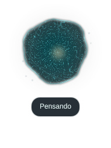

# Mejora 3 · Núcleo orgánico de Limits

Estado: implementado y activado el 31 de octubre de 2026 tras elección del núcleo
orgánico y autorización «Proceed», con petición de mayor complejidad visual.

## Comportamiento entregado

Shader nativo con membrana irregular, filamentos entrelazados, centro luminoso y
partículas orbitales. La energía de la voz cambia la deformación y el brillo; no
se estima a partir del texto ni se vuelve a abrir el micrófono. Investigación,
pensamiento, escucha, ejecución, confirmación, pausa, interrupción y error están
conectados al asistente. Investigación puede mantenerse como actividad subyacente
mientras habla.

Ubicación arriba/derecha, tamaño inicial 172 px y margen superior 76 px (la barra
actual reserva 60 px). Capa Overlay de Wayland, sin exclusión ni foco del teclado.
Los clics solo se capturan en la etiqueta/control; el núcleo es transparente al
puntero. «Detener» cancela únicamente el turno vigente, también durante inferencia.
No puede aprobar operaciones ni ejecutar comandos nuevos.

El widget desaparece en reposo. El shader se actualiza unas 30 veces por segundo
solo visible; dispone de movimiento reducido. Al perder el servicio, deja de
representar actividad vigente; reconectar recupera un snapshot. Detener o cerrar
la interfaz no detiene al asistente.

## Pruebas y evidencia

- **451 pruebas correctas** en Limits. Nuevas regresiones para privacidad y
  permisos, snapshot/reconexión, instancia duplicada, cliente lento, stop de un
  turno antiguo o conexión fugaz, pausa/silencio, PCM atrasado, pipeline cancelado
  mientras espera al router y reproducción medida de caché ElevenLabs/espeak.
- [Audio y cancelación reales](mejora-3/audio-y-cancelacion.json): frase Piper de
  7,653 s, 53 intensidades distintas, foco intacto e investigación conservada bajo
  el habla. Corte mediante el mismo mensaje del botón en **111 ms**. Es una muestra,
  no p50/p95. Decodificado local de audio comprimido probado sin gastar cuota.
- [Servicio real](mejora-3/servicio.json): una orden de reloj enviada por WebSocket
  produjo estados y 34 niveles de voz; volvió a reposo. Se comprobó que detener la
  UI deja activo Limits y que se puede reconectar. Sus 2 episodios sintéticos se
  pusieron en cuarentena con respaldo, sin modificar hechos personales.
- [Pipeline](mejora-3/pipeline-32.json) **32/32** y [router](mejora-3/router-32.json)
  **32/32**. Router p50 1.550 ms, p95 2.913 ms. Sonda grounding: 8 frases sin
  silencios, acciones sin evidencia bloqueadas.
- [Salud tras activar](mejora-3/salud.txt): servicio, puerto, autenticación y audio
  disponibles, **4/4**. Socket real con permisos 0600 en directorio 0700.
- Compilación Python y shader correctos, dependencias compatibles, unidad systemd
  válida y carga nativa de QML sin errores de ejecución. El linter QML independiente
  advierte sobre la factoría PanelWindow/margins de Quickshell; no se presenta como
  un análisis estático limpio.

La aceptación encontró una pérdida de `stop` si un cliente conectaba, enviaba la
orden y cerraba antes de recibir el snapshot inicial. Se corrigió el orden de lectura
antes de responder y se añadió regresión. La prueba real anterior al arreglo falló;
los resultados adjuntos corresponden a la repetición posterior satisfactoria.

## Consumo y límites

[Medición de recursos](mejora-3/recursos.json), muestras de 2 s: 0 % de un núcleo
oculto y 1,5 % animando. RSS aproximadamente 199 MiB oculto y 222 MiB en la vista de
diseño; PSS también se conserva para distinguir memoria compartida. Son procesos y
momentos distintos, no una comparación controlada de crecimiento de memoria.
No hay contador disponible para atribuir consumo de GPU. No se prometen cifras
universales ni consumo cero permanente a partir de una muestra breve.

Se verificó la posición y la capa en el único monitor físico actual, a escala 1.
El seguimiento de monitor al empezar el turno y el ajuste de escala se implementan
con Qt/Quickshell; no se probaron físicamente varios monitores, otras escalas ni
una sesión bloqueada. La capa elegida permite superposición, pero no se realizó
aceptación visual específica sobre todas las modalidades fullscreen.

No se solicitó ni realizó una prueba nueva de micrófono: se mantiene la preferencia
del usuario por pruebas automáticas. La prueba de corte fue programática sobre
la reproducción real. No se consumió OpenCode para implementar ni verificar el widget.

## Uso y reversión

- Instalación idempotente: `./setup-widget.sh`.
- Conexión: `PRESENCE_ENABLED=true` en `.env`; reiniciar `limits.service`.
- Desactivar solo la imagen: `systemctl --user stop limits-widget.service`.
- Quitar el arranque automático: `systemctl --user disable --now limits-widget.service`.
- Deshabilitar la medición visual: `PRESENCE_ENABLED=false` y reiniciar Limits.
- Diseño independiente: `qs -p ui/presence/preview.qml` (simulación; detener al acabar).
- Aceptación optativa: `./limits-env/bin/python scripts/probe_presence.py --live`.

Tamaño, márgenes, opacidad, monitor y movimiento reducido se configuran en
`config.py` mediante las variables documentadas en `.env.example`. No se modificó
la configuración de Hyprland. La unidad del widget reside en el servicio de usuario
y funciona independientemente de la unidad de voz.
